<div align="center">


# EasyServ

**Atendimento e caixa para lojas de serviços: xerox, impressão, currículos, recargas e boletos.**

Programa para Windows, feito em Python, que registra cada atendimento, calcula o troco e a taxa da maquininha, imprime a notinha na impressora térmica e fecha o caixa do dia com relatório em PDF e Excel.

[Baixar a versão mais recente](https://github.com/SrNomu/easyserv/releases/latest)

</div>

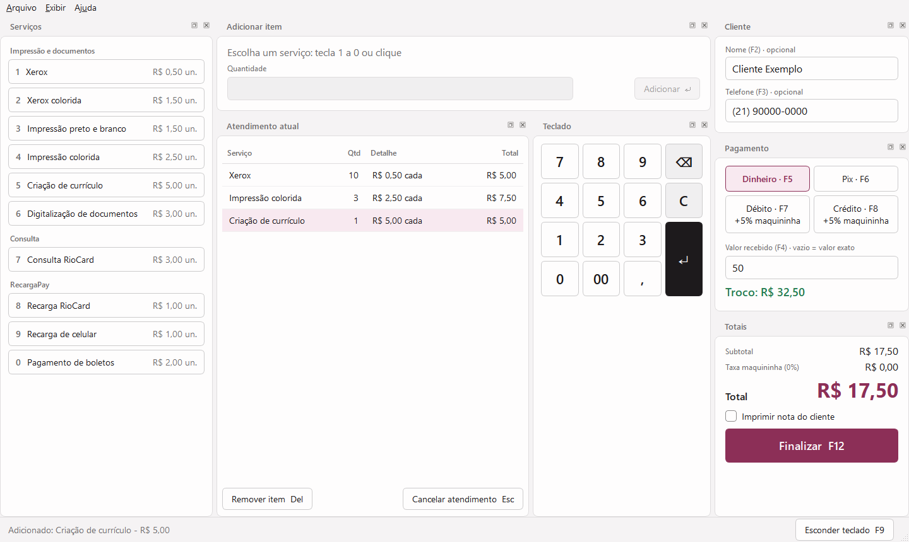

## O que o EasyServ faz

O balcão de uma loja de serviços digitais é cheio de vendas pequenas e rápidas: 10 xerox, uma impressão colorida, um boleto, uma recarga. O EasyServ deixa esse atendimento rápido no teclado (ou com o dedo, num tablet) e cuida das contas, para ninguém errar o troco nem a taxa do cartão.

### Funções

**Atendimento**
- Serviços em botões, por categoria, com tecla de atalho para cada um (1 a 0, ou a tecla que você escolher).
- Teclado numérico na tela e atalhos para tudo: forma de pagamento (F5 a F8), valor recebido, finalizar (F12).
- Troco calculado na hora e taxa da maquininha (débito/crédito) só sobre os serviços que cobram taxa.
- Boletos e recargas: opcionalmente, o funcionário digita o valor do boleto e o programa soma a taxa do serviço ("Valor do boleto: R$ 200,00 + Serviço: R$ 2,00 = Cobrar do cliente: R$ 202,00"). O valor do boleto fica guardado à parte e nunca entra no faturamento.
- Modo treinamento, com um banco separado, para aprender sem mexer no caixa.

**Notinhas**
- Dados da loja (nome, endereço, telefone, CNPJ e logo) preenchidos uma vez só, na janela de boas-vindas, e usados no programa inteiro: título da janela, notinhas, relatórios e páginas de teste.
- Via da loja (salva em .txt) e via do cliente (impressa), com editor visual e pré-visualização.
- Papel de 58 mm, 80 mm ou A4, logo, fonte, alinhamento e o que mostrar em cada via.
- Funciona com qualquer impressora do Windows e, nas térmicas (Tomate, Elgin, Bematech, Epson, Knup, POS-58/POS-80), também em ESC/POS direto: corte do papel, gaveta de dinheiro, negrito, letra grande e logo em preto e branco.
- Botão "Detectar": imprime uma página de teste em cada modo e escolhe o que funcionou.

**Relatório do dia**
- Totais por serviço, categoria, forma de pagamento e hora, e a lista dos atendimentos.
- Relatório A4 com várias páginas e pré-visualização, exportação para PDF e Excel e resumo de fechamento em 80 mm.
- Seção opcional "Repasses (não é faturamento)" com os boletos e recargas recebidos, para conferir a gaveta.

**Do seu jeito**
- Tela "Serviços e preços": criar, renomear, reordenar (arrastando) e remover serviços e categorias.
- Painéis que se movem e se encaixam, layouts prontos (Padrão, Compacto, Touch) e layouts salvos com nome. O Touch se ajusta a telas menores (1440 px ou menos).
- Modo claro e escuro (ou seguindo o Windows), editor de cores e temas salvos.
- Modo tablet: tudo maior, rolagem com o dedo e teclado do Windows ao tocar no campo Nome.

**Cuidados**
- Privacidade: o nome e o telefone do cliente nunca aparecem nos relatórios, e você escolhe se eles ficam guardados (e por quantos dias).
- Backup completo em .zip (atendimentos, serviços, preços, dados da loja e notinhas), na pasta que você escolher (pendrive, Google Drive...), com restauração e backup automático ao fechar o expediente.
- Tela de abertura que confere os arquivos do programa e o banco de dados.
- Atualização automática pelo GitHub Releases: pergunta antes, nunca no meio de um atendimento, confere o SHA-256 e faz backup antes de instalar.
- Os dados ficam em `%APPDATA%\EasyServ`, separados do programa: atualizar nunca apaga nada.

## Telas

| Modo claro | Modo escuro |
|---|---|
|  | 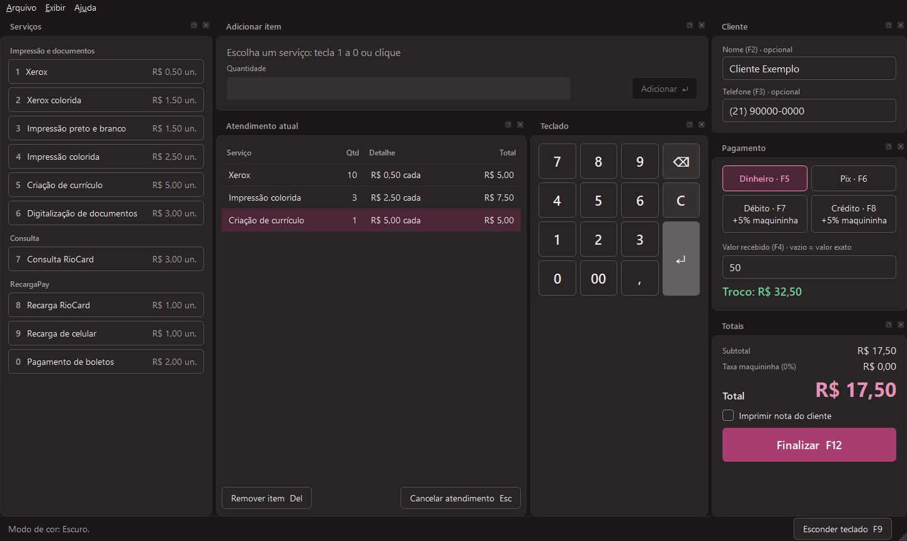 |

**Editor de notinhas** - cada via com as próprias opções e a pré-visualização ao lado.

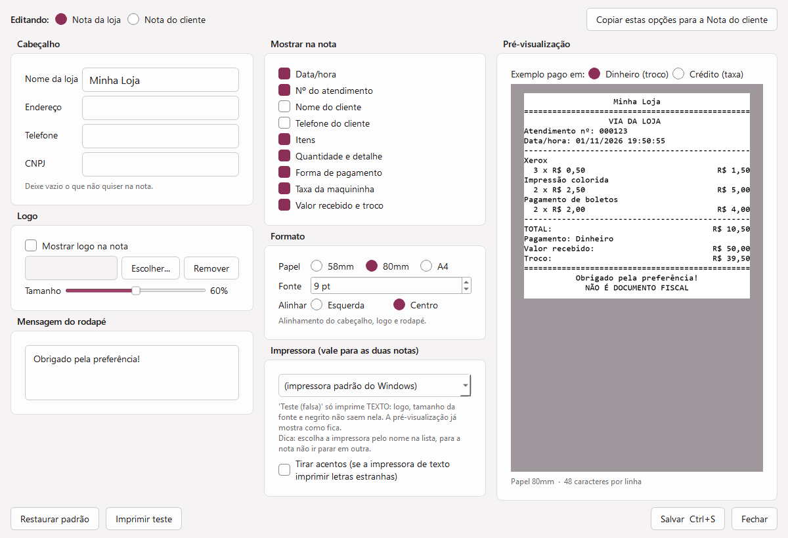

**Relatório do dia** - na tela e em folha A4 (PDF ou impressora).

| Na tela | Folha A4 |
|---|---|
| 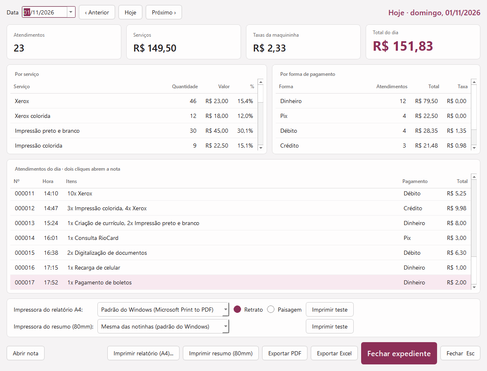 | 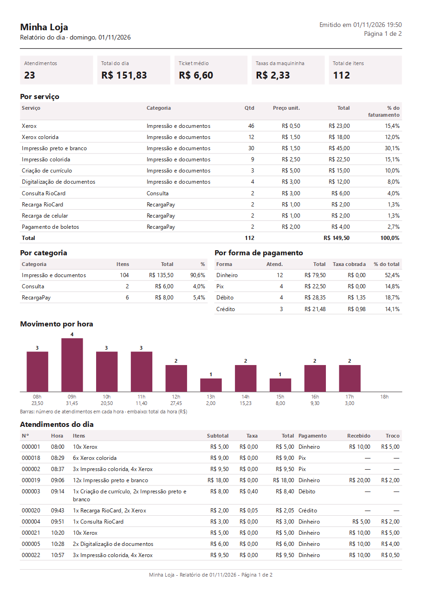 |

**Cores do programa** - temas prontos e cores escolhidas uma a uma, para o modo claro e o escuro.

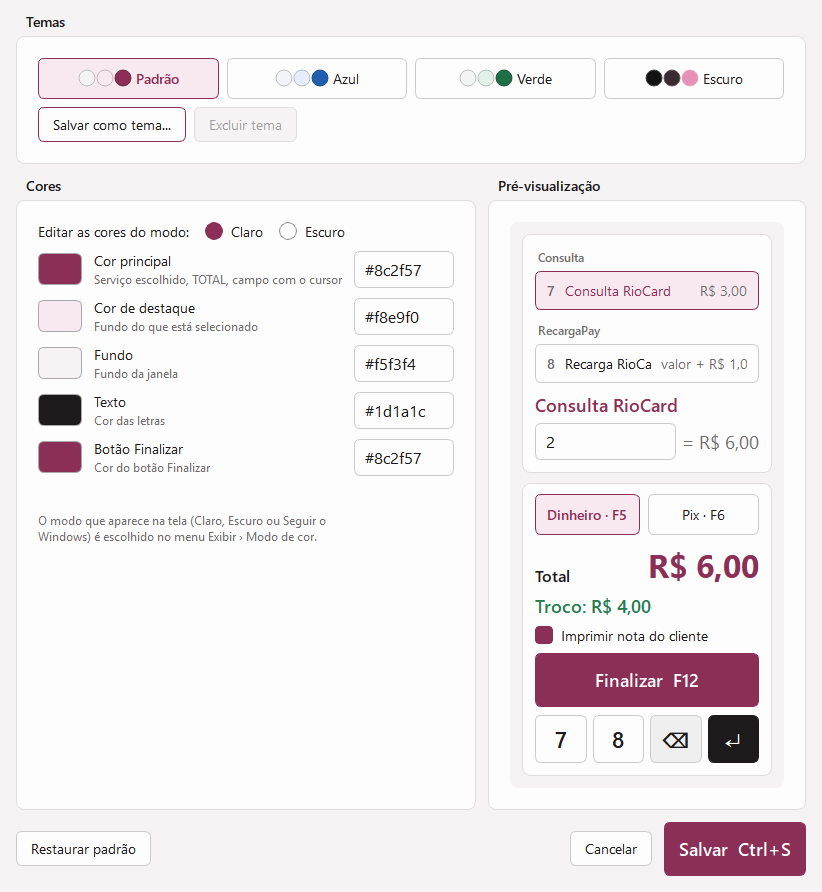

**Layouts** - Compacto e Touch (teclado grande no meio), numa tela de 1440 px.

| Compacto | Touch |
|---|---|
| 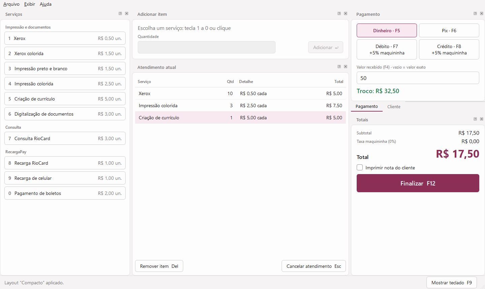 | 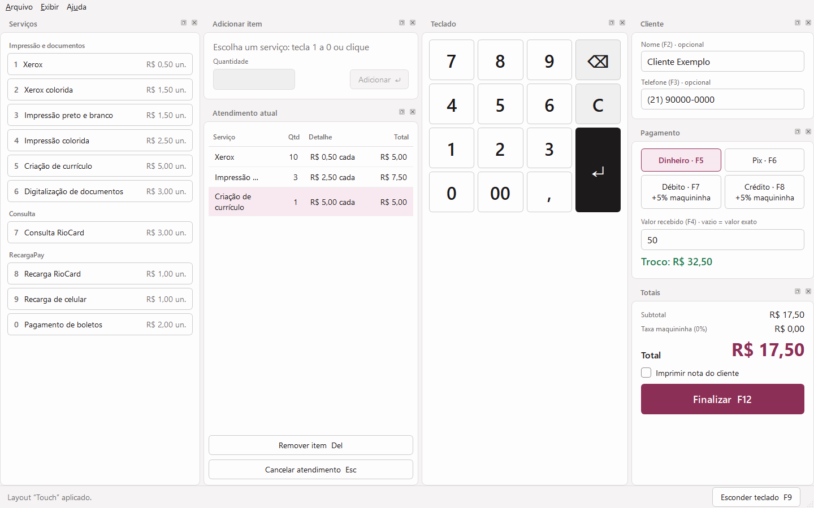 |

**Modo tablet** - tudo maior, para usar com o dedo. Em telas menores, o teclado vai para baixo do "Adicionar item".

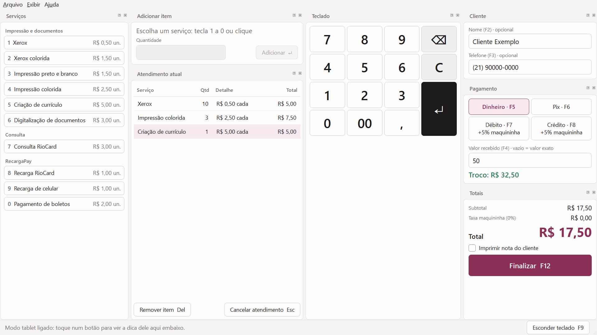

<details>
<summary>Mais telas</summary>

**Dados da sua loja:** a janela de boas-vindas, na primeira vez que o programa abre.

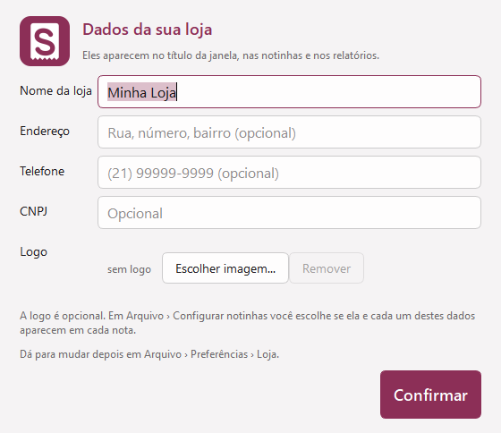

**Boleto com valor:** a conta aparece enquanto o funcionário digita.

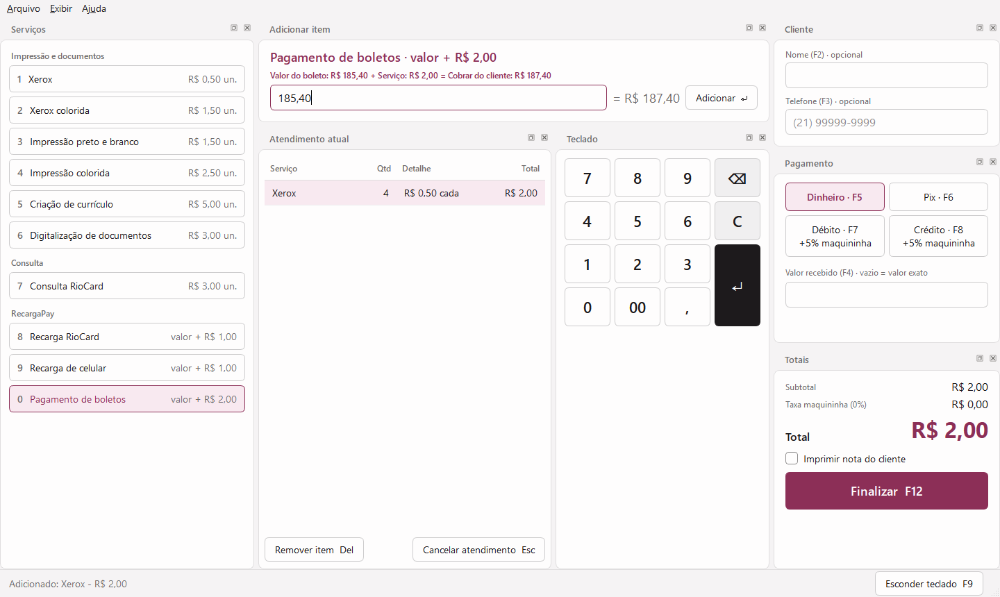

**Serviços e preços**

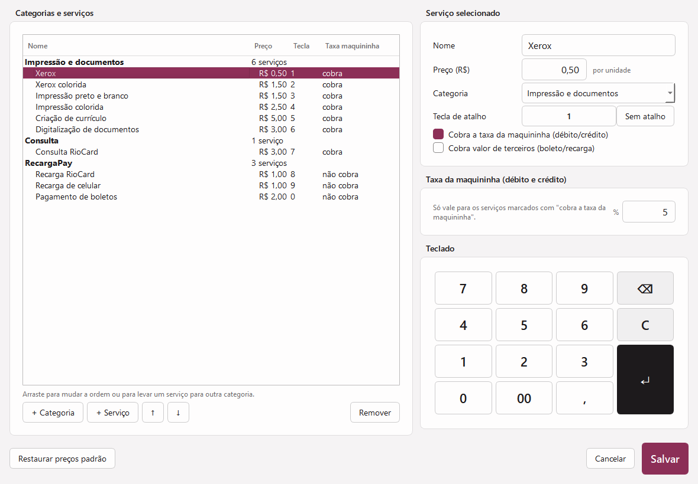

**Preferências**

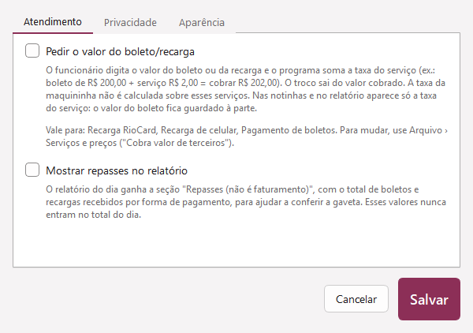

**Tela de abertura e Sobre**

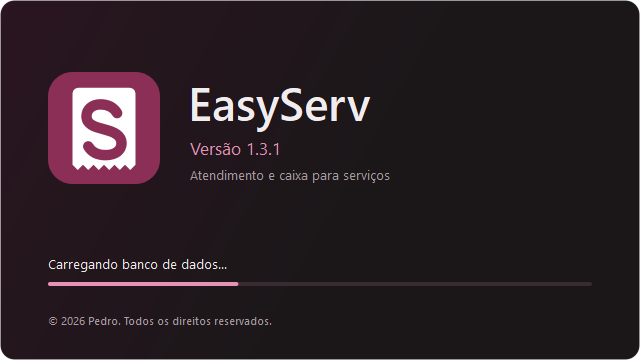

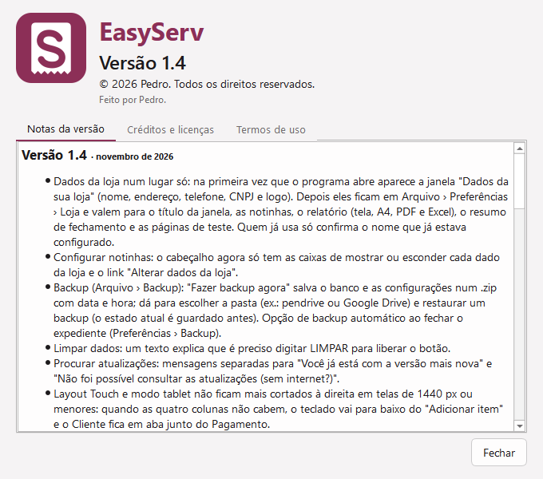

</details>

*Os prints mostram o programa "de fábrica" (loja "Minha Loja"), com atendimentos inventados.*

## Tecnologias

| | |
|---|---|
| **Python 3.13** | toda a lógica do programa |
| **PySide6 (Qt 6)** | a interface: painéis encaixáveis, temas, desenho do relatório A4 e PDF |
| **SQLite** | o banco de dados, num único arquivo, com os valores guardados em centavos |
| **openpyxl** | exportação do relatório para Excel |
| **Pillow** e **pywin32** | desenho e impressão das notinhas no Windows |
| **PyInstaller** e **Inno Setup** | o programa (.exe) e o instalador |
| **Testes automáticos** | 844 verificações em 11 baterias, mais o teste do .exe gerado (veja [Testes](#testes)) |

## Como instalar

1. Baixe o `EasyServ_Setup_x.x.x.exe` na [página de versões](https://github.com/SrNomu/easyserv/releases/latest).
2. Abra o instalador. O Windows pode mostrar o aviso azul **"O Windows protegeu o computador"** (SmartScreen). Ele aparece porque o instalador não tem assinatura digital paga, não porque tenha algo errado. Clique em **Mais informações** e depois em **Executar assim mesmo**.
3. Siga as telas: aceite os termos, escolha a pasta e pronto. O EasyServ ganha atalhos na área de trabalho e no menu Iniciar.

Para conferir o arquivo baixado, compare o SHA-256 dele (no PowerShell: `Get-FileHash .\EasyServ_Setup_x.x.x.exe`) com o do arquivo `.sha256` publicado junto.

## Como rodar pelo código

Precisa do Windows e do Python 3.13.

```bat
git clone https://github.com/SrNomu/easyserv.git
cd easyserv
python -m pip install -r requirements.txt
python main.py
```

Rodando pelo código, os dados (banco, configurações, notas) ficam na própria pasta do projeto; o `.gitignore` não deixa que eles subam para o GitHub.

Para gerar o programa e o instalador, é preciso também o [Inno Setup 6.6 ou mais novo](https://jrsoftware.org/isdl.php) (por causa do modo escuro do instalador). Depois é só rodar `python ferramentas\gerar_instalador.py` (o passo a passo para publicar uma versão está em `ferramentas/COMO_PUBLICAR.txt`).

## Testes

O projeto tem **11 baterias de testes automáticos, com 844 verificações**, na pasta [`testes/`](testes). Elas abrem as telas de verdade e conferem as contas (troco, taxa da maquininha, boletos), as notinhas, os dados da loja, o relatório (tela, PDF, Excel e resumo), os atalhos, os layouts (inclusive em telas de 1280 a 1440 px), o backup e a restauração, a privacidade dos dados do cliente, o instalador, a atualização automática e a impressão (driver do Windows e ESC/POS, com impressoras falsas).

```bat
python testes\rodar_testes.py
```

Além delas, `python testes\teste_exe.py` testa o **programa gerado** (o `EasyServ.exe`, não o código): confere se o módulo de impressão carrega dentro dele. O gerador do instalador roda esse teste sozinho e para se ele falhar.

Cada bateria roda numa cópia do programa, numa pasta temporária: os testes nunca mexem nos dados de verdade, nunca imprimem numa impressora real e nunca acessam a internet.

## Como foi feito

O EasyServ é um projeto meu, criado para a loja da minha mãe. Eu defini os requisitos e as regras de negócio (como a taxa da maquininha e o troco são calculados, o que aparece em cada notinha, o que pode ou não ir para o relatório), testei cada versão, com baterias de testes automáticos, e tomei as decisões sobre o que o programa deveria fazer e como. O código foi desenvolvido com a ajuda do [Claude Code](https://claude.com/claude-code).

O programa começou como uma calculadora simples de serviços e foi crescendo a cada pedido da loja: notinhas, relatório do dia, layouts, temas, modo tablet, instalador e atualização automática.

## Direitos

© 2026 Pedro. Todos os direitos reservados. O código está disponível para visualização como portfólio; uso, cópia ou redistribuição só com autorização.

Os termos completos estão em [LICENCA.txt](LICENCA.txt), e as licenças das bibliotecas usadas, em [LICENCAS_TERCEIROS.txt](LICENCAS_TERCEIROS.txt).

*As notinhas e relatórios do EasyServ não são documentos fiscais.*
